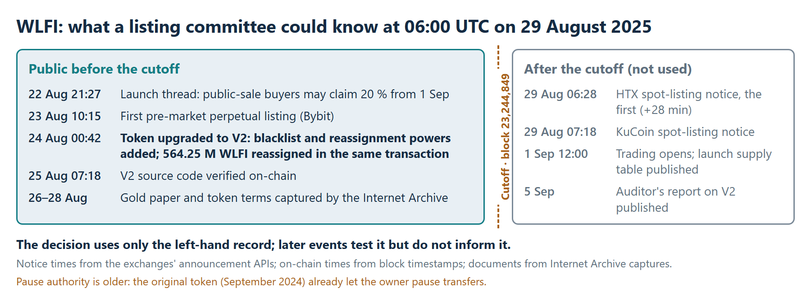
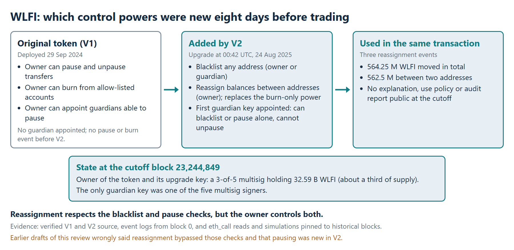
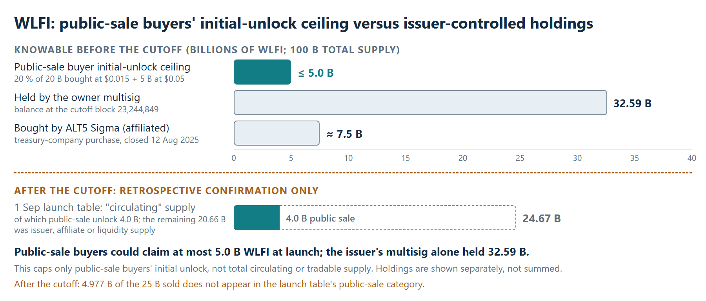

# WLFI | A listing decision at the cutoff

**Historical pre-listing review of World Liberty Financial's WLFI token.** It reconstructs what an exchange listing committee could establish from public evidence at **06:00 UTC on 29 August 2025**, 28 minutes before the first major-exchange spot-listing notice. Everything published later is kept separate.

## Decision question

Should a compliance-sensitive exchange have admitted WLFI to spot trading at launch, on the evidence public at the cutoff? The review uses issuer documents as archived that week, the verified contract source, and Ethereum state read at the cutoff block (**23,244,849**), not today's state.

## Recommendation: defer on the public record

Two findings could not be resolved from public sources, and only the issuer could resolve them.

| At the cutoff | Finding |
| --- | ---: |
| Upgrade adding blacklist and reassignment powers | 24 Aug 2025, 8 days before trading |
| WLFI reassigned inside that upgrade transaction | 564.25 M |
| Owner of the token and its upgrade key | 3-of-5 multisig holding 32.59 B WLFI |
| Public-sale buyer initial-unlock ceiling | ≤ 5.0 B (5 % of supply) |
| Share of the issuer's parent with no publicly identified owner | about 60 % |

## The decisive evidence

**Control over balances.**
- The original 2024 contract already let the issuer's multisig pause transfers.
- The upgrade added blacklisting and balance reassignment, and appointed the first "guardian" key able to blacklist or pause alone.
- Reassignment respects the blacklist and pause checks, but the owner controls both.
- The upgrade transaction itself reassigned 564.25 M WLFI.
- No explanation, audit report or use policy was public at the cutoff.

**Beneficial ownership.** The one disclosed owner of the issuer's parent held about 40 % by June 2025, down from 75 % at the end of 2024. The rest had no publicly identified owner. At a compliance-sensitive exchange, issuer KYB to beneficial owners is a listing requirement, and only the issuer can meet it.

**Public-sale unlock.** The issuer announced on 22 August that public-sale buyers could claim 20 % of their tokens at launch. On 25 B sold, that caps their initial unlock at 5.0 B. It does not cap total tradable supply: the issuer's multisig alone held 32.59 B, and no official circulating-supply figure had been published.

## What only the issuer could answer

- An audit of the deployed code, and a binding policy for blacklisting, pausing and reassignment.
- The purpose of the 24 August reassignments.
- Who holds the multisig keys, how the keys are secured, and whether upgrades are announced in advance.
- The full beneficial ownership of the parent company.
- Which buyers received the 20 % tranche, and the lock terms of issuer and affiliate holdings.

Verified answers could support conditional approval: Ethereum only, spot only, no leverage at launch, calibrated opening limits, and deposit screening against the issuer's blacklist. A refusal would support rejection.

## What this review does not establish

- **Misconduct.** No finding of misconduct is made. Politically exposed persons among the disclosed beneficiaries call for enhanced due diligence; they are not the basis of any rating.
- **Private information.** It does not know what any exchange privately requested or received.
- **Legal status.** It gives no view on securities or MiCA status.
- **The reassignments.** Their purpose is unknown.

## After the cutoff

Later events test the reasoning but did not inform it:
- **Launch table (1 September).** It listed 24.67 B tokens as "circulating", of which 4.0 B came from the public sale. Only 20.023 B of the 25 B sold appears in its public-sale category.
- **Blacklisting.** 272 addresses were blacklisted in the launch window, including a large early investor.
- **Reassignment sequence.** In November 2025, 92 blacklisted accounts were unblacklisted, reassigned and blacklisted again.
- **Ownership.** In February 2026, reporting identified a previously undisclosed 49 % stake bought in January 2025.

No stablecoin depeg, contract exploit, delisting or enforcement action was found.

## Update, 22 October 2026

A second reading of the record found three points this review had not recorded. The recommendation does not change.

- **When reassignment is meant to be used.** The verified V2 source, public from 07:18 UTC on 25 August 2025, documents the reassignment function: it "is meant to be used only if a user loses access to their wallet prior to vesting beginning or when a malicious account acquires WLFI via exploit." The function checks neither condition. The line was added after the auditor's finding M-1, which asked for documentation of when the function would be called. Cyfrin's audit work ran 13 to 15 August 2025; its report is dated 5 September.
- **The token terms.** The token terms in force at the cutoff (updated 25 August 2025, archived on 28 August) reserved the right to "suspend or block your access to the Tokens upon suspicion of any unauthorized access or use", and said the company "may seek to block" users in restricted countries. With the code comment, they gave grounds for the two powers but no process: who approves a freeze or a reassignment, who is told, or how a holder can contest it. "No use policy" in this review means no such process.
- **A delisting after the cutoff.** In June 2026 HTX suspended WLFI trading and moved to delist USD1, saying World Liberty had frozen HTX-linked addresses without due process; a UK sanctions designation of Huobi Global S.A., which HTX calls a separate entity, came first ([The Block, 6 June 2026](https://www.theblock.co/news/business/2026-06-06-htx-to-delist-trump-linked-usd1-after-saying-world-liberty-financial-froze-exchange-linked-addresses-403885)). The earlier line "No ... delisting ... was found" is superseded.

Sources: the verified V2 source ([Etherscan](https://etherscan.io/address/0x0959a6eaea3c23148fe69ddd703c277bc6ad79cc#code)); [Cyfrin's report](https://github.com/Cyfrin/cyfrin-audit-reports/raw/main/reports/2025-09-05-cyfrin-wlf-v2.1.pdf); the token terms as archived ([Wayback, 28 Aug 2025](https://web.archive.org/web/20250828173933id_/https://worldlibertyfinancial.com/wlfi/terms)).

## Sources and scope

[Worked evidence trail](EVIDENCE_TRAIL.md) · [Method and limits](METHOD_AND_LIMITS.md) · [Sources](SOURCES.md)

The full working record (registers, saved RPC responses, scripts and review history) is retained separately for technical diligence. Independent research; not investment or legal advice.
